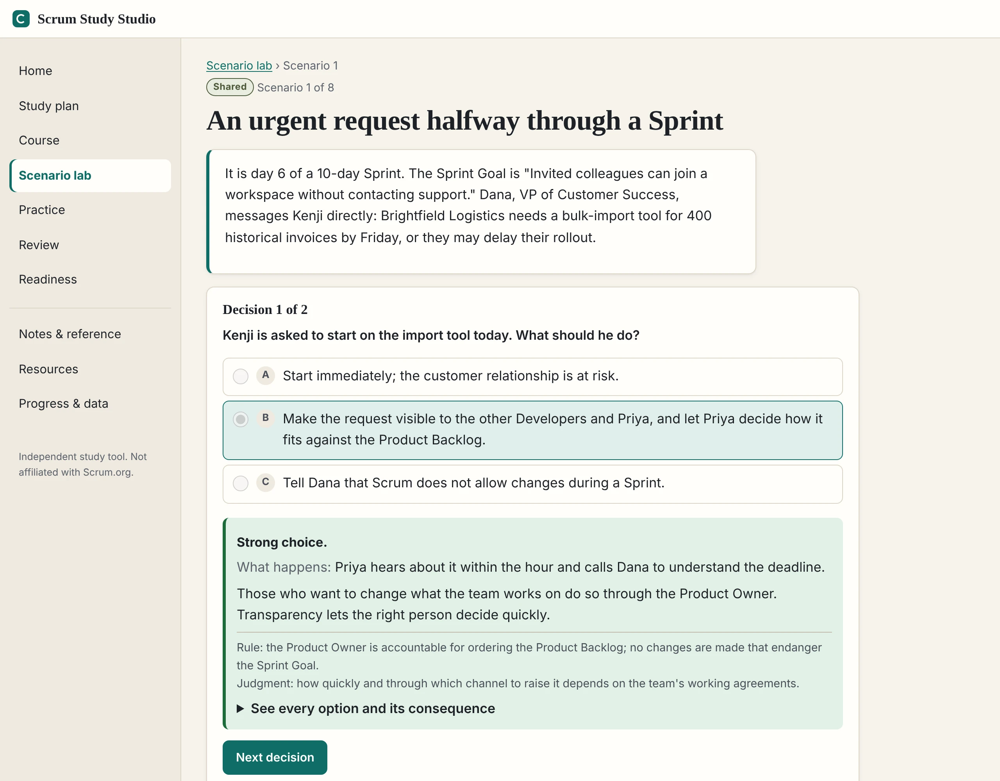
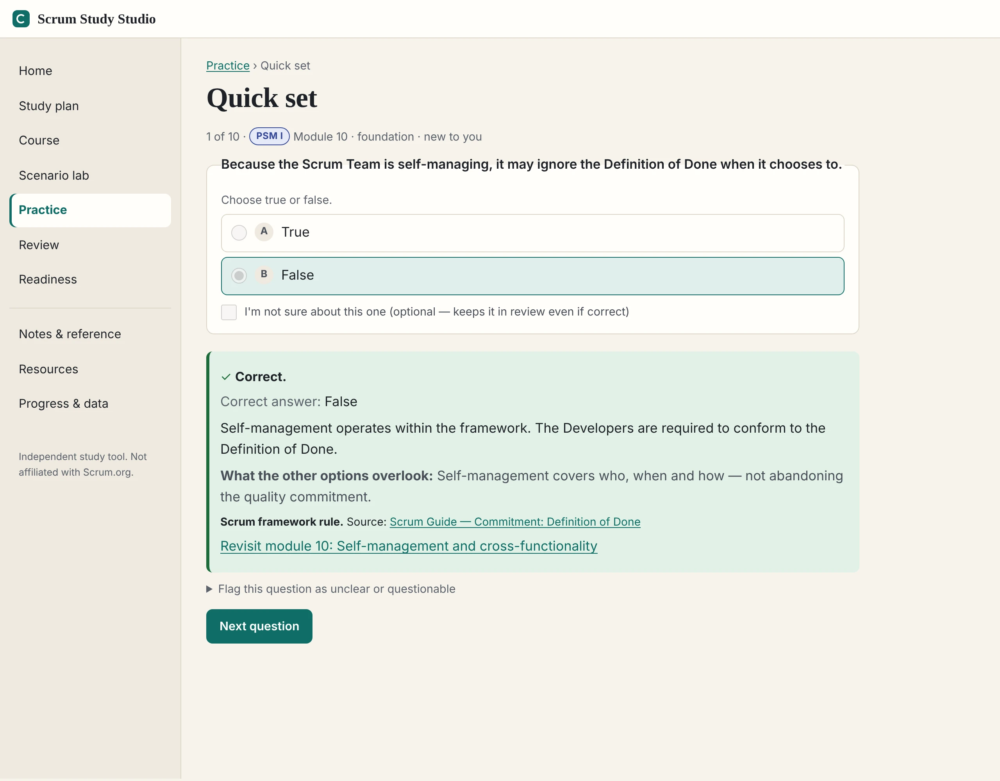
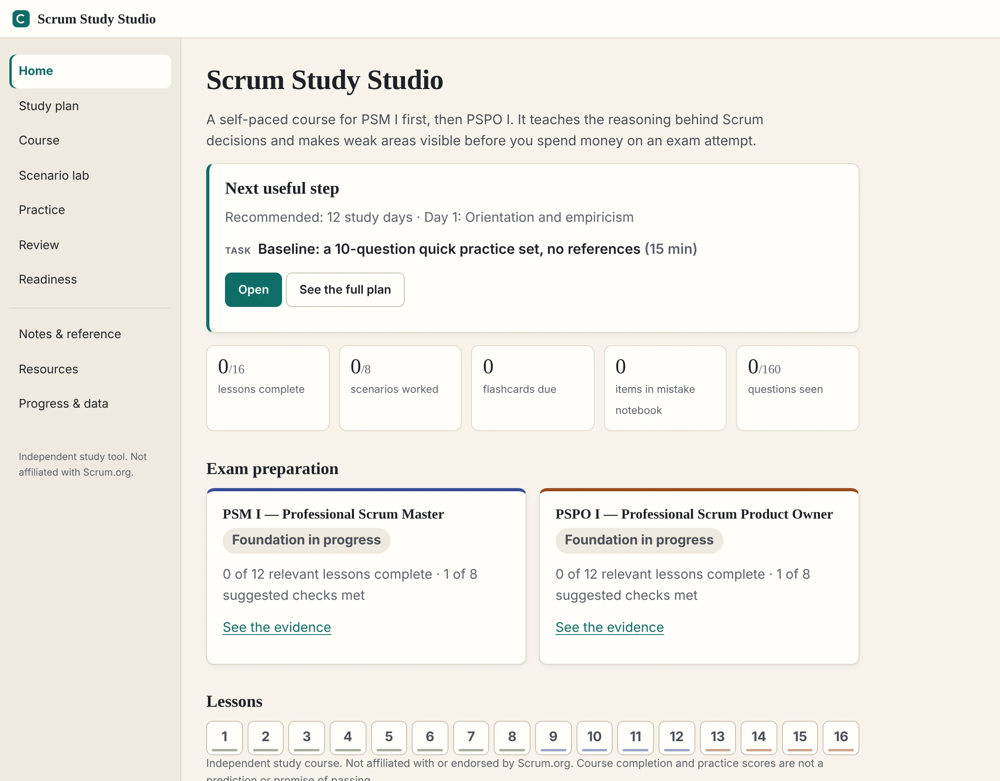

# Scrum Study Studio

**Learn the reasoning behind Scrum, not just the answers, and see your weak spots before you pay for an exam.**

A self-paced course for preparing for **PSM I first, then PSPO I**: lessons, realistic scenarios, 160 original
practice questions, timed rehearsals and spaced flashcards, over 12 study days by default with flexible pacing. It
runs entirely in your browser. There's no account, no build step, and your progress never leaves your device.

[](LICENSE)
[](LICENSE-CONTENT)


<picture>
  <source media="(prefers-color-scheme: dark)" srcset="docs/screenshots/scenario-dark.webp">
  
</picture>

<sub>Independent study tool, not affiliated with or endorsed by Scrum.org. Practice scores are not a prediction of
passing.</sub>

## Why study with it

- **Understand, don't memorize.** Every lesson has an objective, a worked example, a common misconception, a decision
  activity and a teach-back. Feedback explains *why*, and what the wrong answers overlook.
- **Rules versus judgment, made clear.** Feedback labels what the Scrum Guide actually requires, what comes from other
  sources, and what's situational advice, so you know which parts are fixed.
- **Every answer has a source.** Each of the 160 questions cites the exact section it rests on, and every lesson links
  to its reading. Each item's source review is dated and tracked.
- **Practice like the real thing.** Timed 80-question, 60-minute rehearsals for each track use a fixed deadline that
  keeps running even if you close the tab.
- **Remember it next week.** Flashcards come back after about 1, 3 and 7 days, and a mistake notebook brings back
  anything you missed or weren't sure about.
- **Honest readiness.** Separate PSM I and PSPO I evidence panels show what you've done and what's left. There are no
  pass predictions.
- **Private by default.** Progress stays in your browser, with export, import and reset when you want them.

<table>
  <tr>
    <td width="50%"><picture>
  <source media="(prefers-color-scheme: dark)" srcset="docs/screenshots/practice-dark.webp">
  
</picture></td>
    <td width="50%"><picture>
  <source media="(prefers-color-scheme: dark)" srcset="docs/screenshots/home-dark.webp">
  
</picture></td>
  </tr>
</table>

## What's in it

| Area | Contents |
| --- | --- |
| Course | 16 modules (8 shared, 4 PSM, 4 PSPO). Each has an objective, explanation, worked example (the fictional "Launchpad" onboarding portal), misconception, decision or sort activity, teach-back with rubric, five-question check, and source links. |
| Scenario lab | 8 scenarios with 2–3 decision points each; feedback separates framework rules from situational judgment. |
| Question bank | 160 original questions (80 shared, 40 PSM, 40 PSPO): single answer, multiple answer, true/false. Each has an explanation, what the distractors overlook, a source, and a rule/judgment label. |
| Practice | Quick sets, topic sets, missed/uncertain questions, and timed 80-question / 60-minute course rehearsals per track. |
| Review | 48 flashcards with ~1/3/7-day intervals, a mistake notebook, and locally flagged questions. |
| Plan | 12-day recommended schedule with flexible pacing, editable start date, carry-forward. |
| Readiness | Separate PSM I / PSPO I evidence panels, self-reported Open results, no pass predictions. |
| Data | Progress in browser storage, export/import with validation, confirmed reset. |

## Run locally

Open `dist/index.html` directly, or serve the folder:

```bash
python -m http.server 8123 --directory dist
```

## Checks

```bash
npm run validate
```

```bash
npm test
```

```bash
npm run register
```

- `validate` checks content counts, IDs, answer keys, sources/anchors, plans and risky wording. Add `:links` (`npm run validate:links`) to request every external URL; scrum.org answers automated requests with HTTP 403, so verify those pages in a browser.
- `test` covers scoring, option shuffling, rehearsal sampling, the absolute deadline, review scheduling, persistence, storage failure, strict import validation, stale-tab protection, legacy progress migration, start-date changes and readiness.
- `register` regenerates `content-register.md` from the dated item reviews and competency map, including lessons, questions, scenarios, cards, resource references and resolved findings. It refuses stale source reviews.

`node scripts/screenshots.js` regenerates the screenshots in this README. It needs Playwright with Chromium.

## Structure

```
dist/                     publishable site (hosting config points here)
  index.html, styles.css
  js/core.js              pure logic (scoring, sampling, deadlines, review, validation)
  js/store.js             browser-local progress with visible fallback
  js/ui.js                rendering helpers, plan progress, readiness evidence
  js/views-*.js           pages
  js/app.js               router and shell
  js/data/*.js            curriculum, questions, scenarios, flashcards, plans, sources
scripts/                  validation, tests, register generator, screenshots (not published)
docs/                     technical guide and README screenshots
content-register.md       generated source-to-content register
source-audit.json          dated source reviews tied to each learning item's content
competency-map.json        all published exam-focus areas and eligible course practice
.openai/hosting.json      existing Sites hosting identity (static directory: dist)
```

## Updating content

Edit the data files in `dist/js/data/`. When a question changes materially, bump its `v` so earlier
attempts are not treated as mastery of the revised item. Bump `SSS.CONTENT_VERSION` in `sources.js`
and the `?v=` query strings in `index.html` when publishing an update. Then run the three checks above.

Content changes require a fresh source review and updated `source-audit.json` records. The checks
detect unreviewed changes; regenerating a register does not itself certify the content. Update
`competency-map.json` when a question's topic changes. Keep precise article/section citations and
distinguish Scrum Guide rules from separate concepts and course judgment.

## Under the hood (TL;DR)

- Plain HTML, CSS and JavaScript in `dist/`, loaded in order onto one `window.SSS` namespace. No framework, no
  dependencies, no build. It opens straight from disk or any static host.
- Content is data: modules, questions, scenarios, flashcards and plans live in `dist/js/data/`, and the same files load
  into Node for the checks.
- Every learning item has a dated source review holding a SHA-256 digest of the item. Change the item and its review
  goes stale, so the checks catch content that hasn't been re-reviewed.
- Progress is one versioned JSON object in `localStorage`. Imports are strictly validated. A second tab that falls
  behind turns read-only instead of overwriting newer work. Rehearsals use an absolute deadline.
- Readiness is a checklist of evidence, such as rehearsals at 90%+ on separate days and delayed flashcard recall,
  rather than a score.

For the full tour (content model, audit trail, storage, practice and rehearsals, flashcards, readiness rules, checks
and a code map) read **[docs/technical.md](docs/technical.md)**.

## License

The course is shared under two licences:

- **Code:** [MIT](LICENSE). That's the page, styles and scripts in `dist/` outside `dist/js/data/`, plus `scripts/`.
- **Course content:** [CC BY-SA 4.0](LICENSE-CONTENT). That's the lessons, questions, scenarios, flashcards and plans
  in `dist/js/data/`, the source register and audit files, the changelog and `docs/`.

Parts of the content adapt **The Scrum Guide** © 2020 Ken Schwaber and Jeff Sutherland
([scrumguides.org](https://scrumguides.org)), which is published under CC BY-SA 4.0. That's why the content uses the
same licence. If you share or adapt the content, credit both this course and the Scrum Guide, and keep the same
licence.

The course also links to many other references, including Scrum.org articles and the Evidence-Based Management Guide.
These are described in the course's own words, not reproduced, and remain under their owners' terms.
[content-register.md](content-register.md) lists every source and where it's used.

Scrum.org, Professional Scrum, PSM and PSPO are trademarks of Scrum.org, used here only to name the assessments.
Scrum Study Studio is an independent study tool and isn't affiliated with or endorsed by Scrum.org. Practice scores
are not a prediction of passing.
